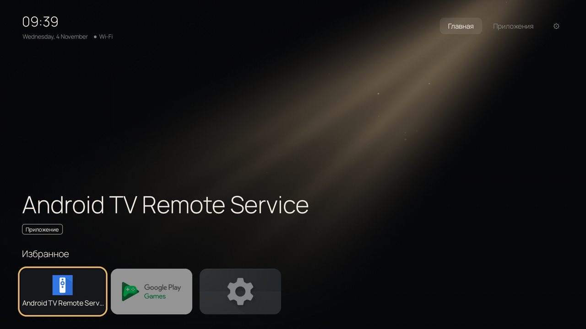
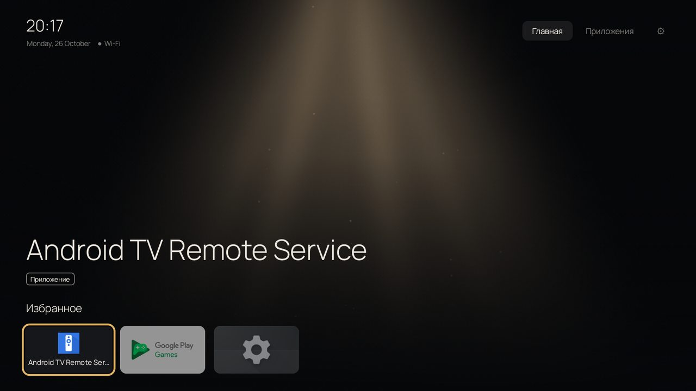
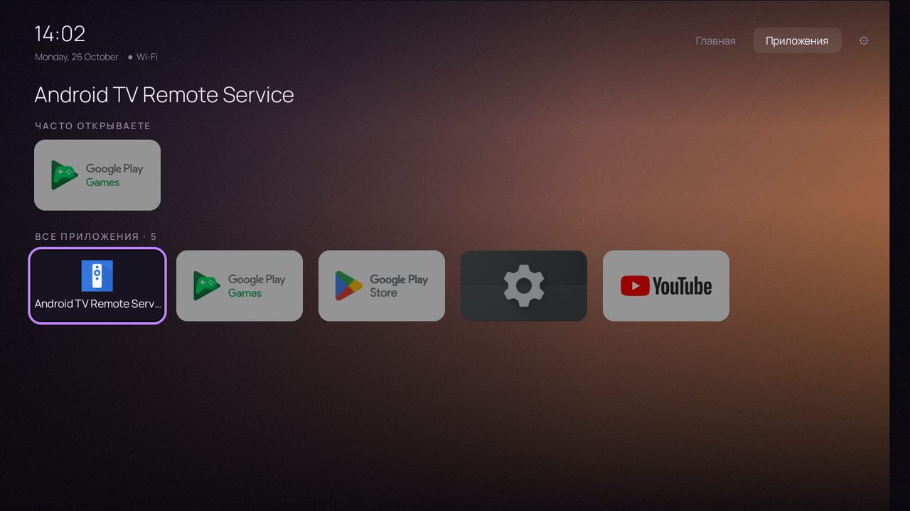
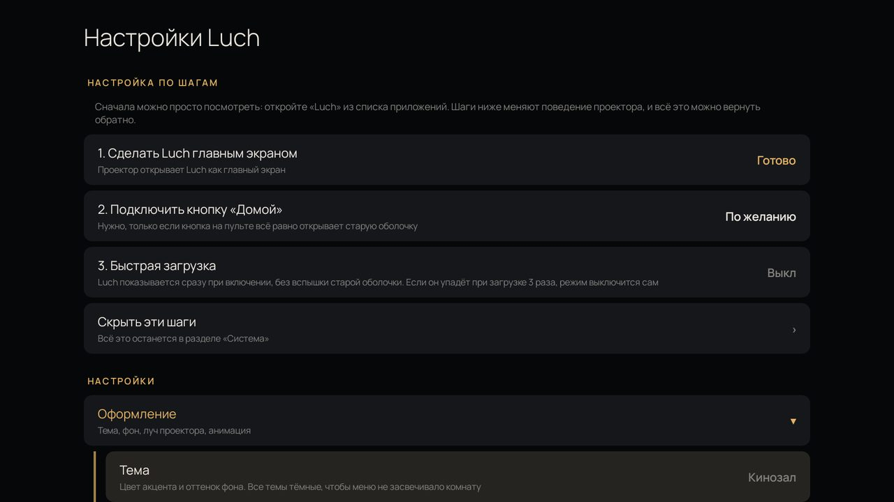
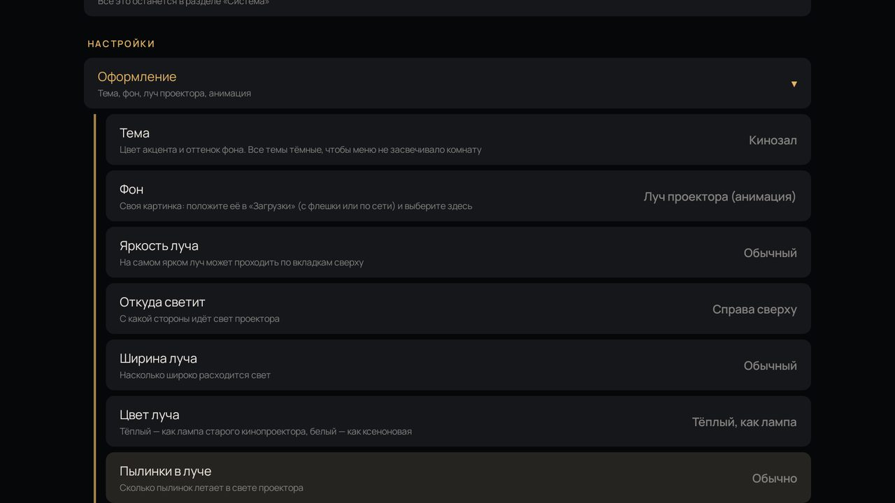

<p align="center"></p>

# Luch

Лёгкий лаунчер для Android TV и проекторов. APK версии 1.4 занимает 115 239 байт (112,5 КиБ).
Работает без интернета и рекламы. Минимальная версия Android — 7.0.

Сделан для дешёвых проекторов, где вместо нормального меню стоит тормозная рекламная оболочка
производителя, а режим разработчика закрыт.



## Что умеет

- Главный экран в стиле стриминговых сервисов: фон на весь экран, крупное название, ряд избранного.
- Для главной и вкладки «Приложения» можно выбрать 4, 5 или 6 плиток в ряд, скрыть названия и включить второй ряд для главной и «Часто открываете». Надписи внутри фирменных баннеров относятся к изображениям самих приложений.
- 6 тёмных тем (светлых нет специально, чтобы меню не засвечивало комнату).
- **Луч кинопроектора** (фон по умолчанию): конус света с лучами внутри, пылинки и лёгкое
  мерцание плёнки. Настраиваются яркость, ширина, сторона (справа, по центру, слева), цвет
  (тёплая лампа, белый ксенон, цвет темы) и количество пылинок.
- Другие фоны: свечение темы, своя картинка с медленным наездом, размытый баннер,
  «Огни зала», плёночное зерно. Фон продолжает двигаться при листании. В разделе «Оформление → Фон → Видео с устройства» можно выбрать локальное видео. Оно играет по кругу без звука, пока видно меню.
- **Настройка по шагам**: главный экран, кнопка «Домой», быстрая загрузка. Сначала Luch можно
  просто посмотреть, ничего не меняя в системе.
- Перехват кнопки «Домой» на пульте через спецвозможности, как у Projectivy. Можно выбрать,
  что она открывает: «Главную» или «Приложения».
- **Быстрая загрузка** позволяет Android открыть Luch до разблокировки (`directBootAware`). Первый экран зависит от прошивки. При переключении этого режима Android может ещё раз попросить выбрать главный экран.
- Плитка HDMI (на прошивках HiSilicon), автозапуск приложения при включении, скрытие приложений.
- В режиме ожидания «Луч ищет часы» цифры сохраняют размер. При смене минуты на часах устройства выбираются новое место и случайный угол для прожектора. Если выбран фон «Луч проектора», заставка использует его оформление. С любым другим фоном включаются штатные параметры лампы.
- В «Главный экран → Температура устройства» можно включить индикатор рядом с сетью. У числа указано, откуда оно получено: светодиод, SoC, CPU или аккумулятор. Если прошивка скрывает градусы, Luch может показать сообщённый системой уровень нагрева. Когда показаний нет, появится «— °C».
- Выбор приложения для автозапуска сохраняется, даже если его обновление меняет стартовый экран. После перезагрузки и разблокировки Luch открывает приложение один раз, когда домашний экран активен. В настройках можно выбрать «Не запускать ничего».
- **Восстановление после сбоя.** При ошибке запуска главного экрана Luch выключает быструю загрузку, автозапуск и перехват «Домой». Если доступна другая домашняя оболочка, Luch уступает ей место. При нескольких оболочках Android может предложить выбор. Если остался только служебный экран ожидания Android TV, Luch сохраняет вход через «Домой» в настройки устройства. Защита также срабатывает после трёх аварий приложения за три минуты или при следующем запуске после трёх незавершённых стартов главного экрана. Чтобы снова включить Luch, откройте его настройки и нажмите «Вернуть лаунчер».

| Луч по центру | Приложения |
|---|---|
|  |  |

| Настройка по шагам | Настройки луча |
|---|---|
|  |  |

## Установка

Готовый APK лежит в [Releases](../../releases).

1. Установите выбранный APK с флешки через файловый менеджер. Для обновления с компьютера используйте `adb install -r имя-файла.apk`.
   При обновлении официальной версии устанавливайте APK поверх прежней, чтобы сохранить настройки. При изменении списка домашних приложений Android может снова предложить выбрать главный экран.
2. Откройте «Luch» из списка приложений. Так можно попробовать меню, обои и часы до назначения Luch главным экраном.
3. Понравилось? Откройте «Настройки Luch» и пройдите шаги наверху:
   - **Сделать Luch главным экраном**.
   - **Подключить кнопку «Домой»**, если кнопка на пульте всё равно открывает старую оболочку.
     На системном экране включите «Luch: кнопка «Домой»». Если стоит Projectivy, его службу
     там же лучше выключить.
   - **Быстрая загрузка**, если хотите попробовать ранний старт Luch на вашем устройстве.

Если прямой переход в спецвозможности закрывается, нажмите «Открыть настройки». В полном меню Android TV откройте «Настройки устройства» → «Специальные возможности» и выберите службу Luch. Шаг нужен, если хотите подключить кнопку «Домой».
Если пункта в настройках устройства нет, но есть ADB, службу можно включить с компьютера.
Сначала посмотрите действующие службы командой `adb shell settings get secure enabled_accessibility_services`. Следующие команды подходят только для пустого списка. Если службы уже включены, сохраните все записи и добавьте компонент Luch через двоеточие.

```
adb shell settings put secure enabled_accessibility_services com.local.tvlauncher/com.local.tvlauncher.KeyService
adb shell settings put secure accessibility_enabled 1
```

Запасной способ назначить Luch главным экраном с компьютера в обычном режиме:

```
adb shell cmd package set-home-activity com.local.tvlauncher/.HomeActivity
```

**Как откатить.** В настройках Luch, раздел «Система» → «Другая оболочка», или просто удалите
приложение. Прошивку Luch не трогает и root не использует.

## Разрешения

- Спецвозможности: только перехват кнопки «Домой» и замена оболочки производителя на экране.
- Доступ к файлам для выбора фото и локального видео. При выборе видео через системный диалог достаточно разрешения на выбранный файл.
- Состояние сети: значок Wi-Fi/Ethernet у часов.

## Сборка

Без Gradle и Android Studio, одним PowerShell-скриптом: aapt2 → javac → R8 → zipalign → apksigner.

Нужно: Android SDK (build-tools 34.0.0, platform android-34) в `C:\Android`, JDK 17.
Пути меняются в начале `build.ps1`.

```
powershell -ExecutionPolicy Bypass -File build.ps1
```

Ключ `-Plain` собирает обычным d8 без R8 (APK примерно на 12 КБ больше, имена классов в отчётах
о падениях настоящие). При первой сборке создаётся свой ключ подписи `tvlauncher.jks`.
Поставить такую сборку поверх APK из Releases не получится: подписи разные, сначала удалите старую.

## Лицензия

Код: [MIT](LICENSE). Шрифт [Manrope](https://github.com/sharanda/manrope):
SIL Open Font License 1.1, см. [assets/OFL.txt](assets/OFL.txt).
