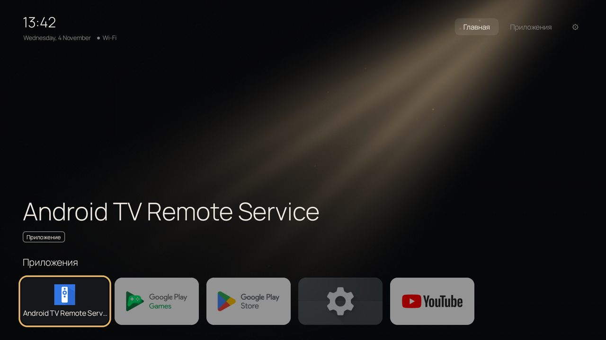
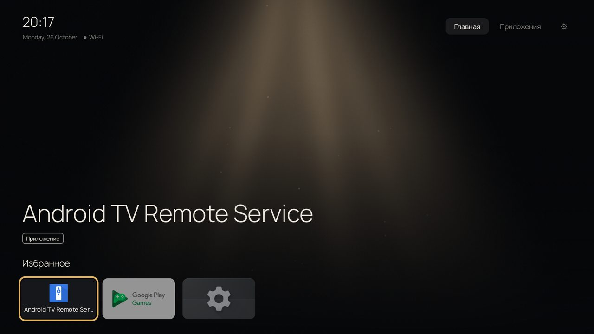
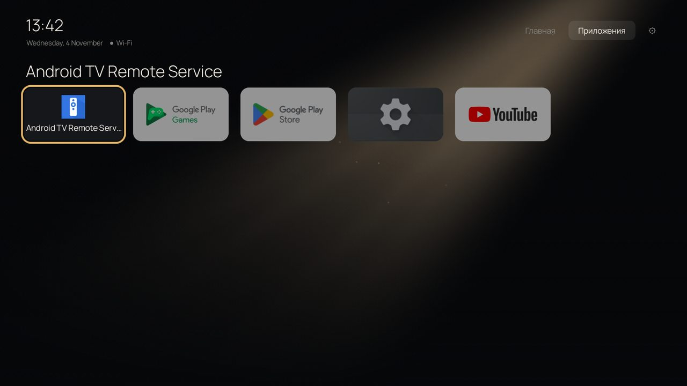
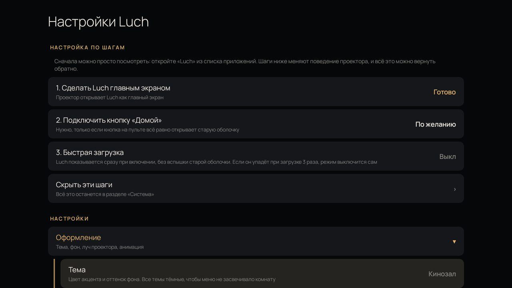

<p align="center"></p>

# Luch

Лёгкий лаунчер для Android TV и проекторов. APK меньше 100 КБ, без рекламы, без интернета,
без сбора данных. Android 7.0 и новее, проверен на Android TV 12 (проектор на HiSilicon).

Сделан для дешёвых проекторов, где вместо нормального меню стоит тормозная рекламная оболочка
производителя, а режим разработчика закрыт.



## Что умеет

- Главный экран в стиле стриминговых сервисов: фон на весь экран, крупное название, ряд избранного.
- Вкладка «Приложения» с рядом «Часто открываете».
- 6 тёмных тем (светлых нет специально, чтобы меню не засвечивало комнату).
- **Луч кинопроектора** (фон по умолчанию): конус света с лучами внутри, пылинки и лёгкое
  мерцание плёнки. Настраиваются яркость, ширина, сторона (справа, по центру, слева), цвет
  (тёплая лампа, белый ксенон, цвет темы) и количество пылинок.
- Другие фоны: свечение темы, своя картинка с медленным наездом, размытый баннер,
  «Огни зала», плёночное зерно. Анимация 12 или 24 кадра в секунду, при листании пауза.
- **Настройка по шагам**: главный экран, кнопка «Домой», быстрая загрузка. Сначала Luch можно
  просто посмотреть, ничего не меняя в системе.
- Перехват кнопки «Домой» на пульте через спецвозможности, как у Projectivy. Можно выбрать,
  что она открывает: «Главную» или «Приложения».
- **Быстрая загрузка**: лаунчер показывается сразу при включении, без вспышки оболочки
  производителя (`directBootAware`).
- Плитка HDMI (на прошивках HiSilicon), автозапуск приложения при включении, скрытие приложений.
- Затемнение при бездействии или слайд-шоу из своих фото.
- **Защита от поломки**: если лаунчер падает 3 раза за 3 минуты, он сам выключает быструю загрузку,
  а при повторе снимает себя с главного экрана, и система возвращает стандартную оболочку.

| Луч по центру | Приложения |
|---|---|
|  |  |



## Установка

Готовый APK лежит в [Releases](../../releases).

1. Установите APK: с флешки через файловый менеджер или `adb install Luch-1.3.apk`.
   После установки ничего не меняется, текущий лаунчер остаётся главным.
   Новая версия ставится поверх старой, настройки сохраняются.
2. Откройте «Luch» из списка приложений и посмотрите. «Домой» вернёт в прежнюю оболочку,
   в системе ничего не меняется.
3. Понравилось? Откройте «Настройки Luch» и пройдите шаги наверху:
   - **Сделать Luch главным экраном**.
   - **Подключить кнопку «Домой»**, если кнопка на пульте всё равно открывает старую оболочку.
     На системном экране включите «Luch: кнопка «Домой»». Если стоит Projectivy, его службу
     там же лучше выключить.
   - **Быстрая загрузка**, если нужно убрать вспышку старой оболочки при включении.

Если экран спецвозможностей не открывается, Luch покажет, как включить службу вручную.
Если пункта в настройках устройства нет, но есть ADB, выполните один раз команду ниже
и снова нажмите «Подключить кнопку «Домой»»: служба включится сама.

```
adb shell pm grant com.local.tvlauncher android.permission.WRITE_SECURE_SETTINGS
```

Запасной способ сделать Luch главным экраном с компьютера:

```
adb shell cmd package set-home-activity com.local.tvlauncher/.HomeEarlyActivity
```

**Как откатить.** В настройках Luch, раздел «Система» → «Другая оболочка», или просто удалите
приложение. Прошивку Luch не трогает и root не использует.

## Разрешения

- Спецвозможности: только перехват кнопки «Домой» и замена оболочки производителя на экране.
- Доступ к файлам: только чтобы прочитать выбранную картинку или фото для слайд-шоу.
- Состояние сети: значок Wi-Fi/Ethernet у часов.
- `WRITE_SECURE_SETTINGS`: не выдаётся при установке и ничего не даёт сама по себе. Нужна только
  если выдать её через ADB, чтобы включить и выключить службу кнопки «Домой» без системного экрана.

## Сборка

Без Gradle и Android Studio, одним PowerShell-скриптом: aapt2 → javac → R8 → zipalign → apksigner.

Нужно: Android SDK (build-tools 34.0.0, platform android-34) в `C:\Android`, JDK 17.
Пути меняются в начале `build.ps1`.

```
powershell -ExecutionPolicy Bypass -File build.ps1
```

Ключ `-Plain` собирает обычным d8 без R8 (APK примерно на 12 КБ больше, имена классов в отчётах
о падениях настоящие). При первой сборке создаётся свой ключ подписи `tvlauncher.jks`.
Поставить такую сборку поверх APK из Releases не получится: подписи разные, сначала удалите старую.

## Лицензия

Код: [MIT](LICENSE). Шрифт [Manrope](https://github.com/sharanda/manrope):
SIL Open Font License 1.1, см. [assets/OFL.txt](assets/OFL.txt).
